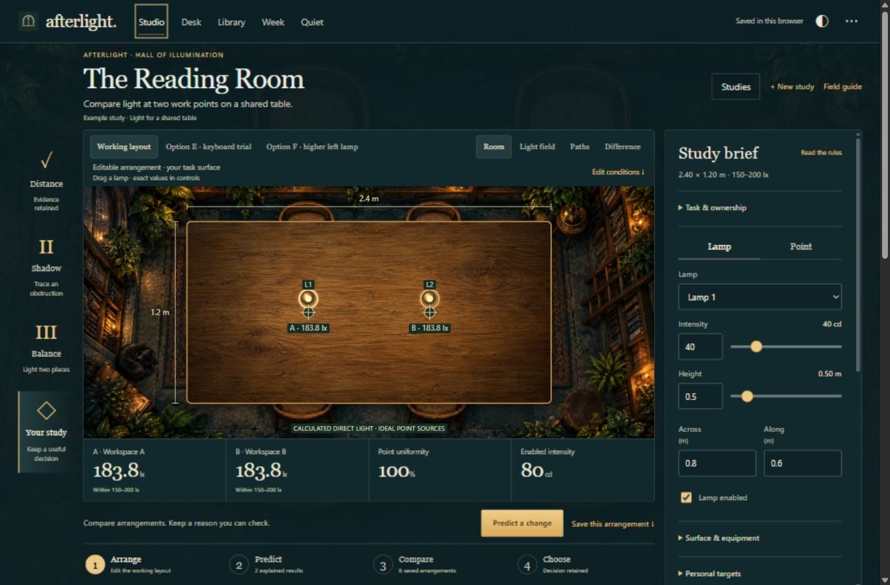
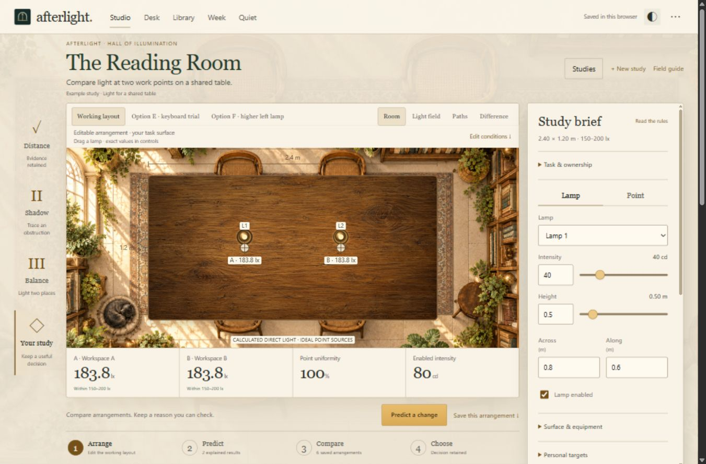
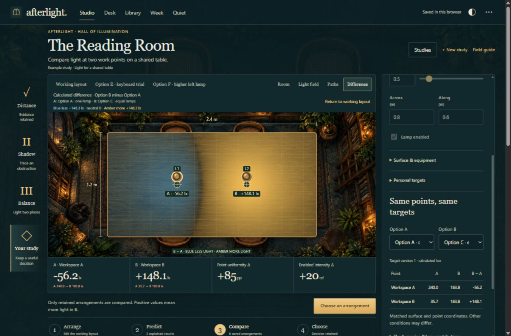

<div align="center">

# Afterlight

### Arrange light. Predict a change. Keep the evidence.

An interactive lighting study and source-based workspace for turning an explanation into a decision you can inspect.

[Browser demo](https://starright00631-dev.github.io/afterlight/) · [Releases](https://github.com/starright00631-dev/afterlight/releases) · [Physical model](#physical-model) · [License](LICENSE) · [Credits](CREDITS.md)



</div>

The Reading Room combines an illustrated environment with a deterministic direct-light model. Lamps, measurement points, screens, fields and numerical readings are live; the surrounding artwork is decorative. Day and night appearances use the same calculations.

| Day appearance | Signed difference between saved arrangements |
| --- | --- |
|  |  |

These are screenshots of the running application with a retained example study. Values shown in lux are calculations, not measurements of a physical room.

## From explanation to evidence

An explanation becomes useful when it predicts a change that can be checked. Afterlight records the expected outcome, original conditions, calculations and a separate conclusion. A correct prediction does not establish mastery or learning gains.

Start with a lighting question, such as whether two work points on a shared table can meet your chosen range. Use the distance, shadow and balance commissions to explore the rules, or create a personal study.

| Step | What you do | What is retained |
| --- | --- | --- |
| **Arrange** | Move lamps or use exact numeric controls; set points and personal targets. | Saved arrangements with their own geometry and calculated readings. |
| **Predict** | Commit an expected change and an explanation, then edit the proposal and run it. | The frozen baseline, original hypothesis, result and separate conclusion. Proposed readings stay covered until Run. |
| **Compare** | Select two saved arrangements on the same surface and point coordinates. | Point readings, target margins, lamp contributions and a signed **B minus A** field. |
| **Choose** | Keep an arrangement with a reason, supporting evidence and a next check. | The selected comparison and target revision, preserved when later edits occur. |

**Room**, **Light field** and **Paths** show the layout, distribution and direct-light paths. **Difference** compares retained arrangements on a symmetric scale: amber means more light in B, blue means less. Mismatched setups are rejected. Changing several controls at once does not isolate one cause.

Actual meter readings can be recorded separately, with their instrument and context. They remain distinct from calculations and do not automatically calibrate the model.

## One study, five workspaces

| Workspace | Purpose |
| --- | --- |
| **Studio** | Build the study, test predictions, compare arrangements and retain a decision. |
| **Desk** | Keep source passages beside explanations, recall attempts and drafts. |
| **Library** | Preserve imported sources and the passages supporting your work. |
| **Week** | Schedule concrete checks or outputs using estimates, prerequisites, deadlines and rest gaps. |
| **Quiet** | Save a handoff note and next step; optionally start a timer or locally synthesized rain. |

A retained study decision can become source-linked work in Desk or a concrete check in Week. Scheduling and review intervals are explicit heuristics; these workspaces do not change the physical model.

## Choose how to run

Open the [browser demo](https://starright00631-dev.github.io/afterlight/) without installation, or download the local application for provider connections.

| Capability | Browser build | Local server |
| --- | --- | --- |
| Studio, Desk, Library, Week and Quiet | Available | Available |
| Text, Markdown and selectable-text PDF import | Available | Available |
| Study calculations, records, planning and appearance controls | Available | Available |
| Workspace/study backups, HTML/CSV reports and other exports | Available | Available |
| Optional model-provider assistance | Disabled | Available when you configure a provider |

The browser build serves its code, artwork and PDF.js resources from the same site. No Afterlight account or provider is required. Opening `index.html` directly from disk is unsupported.

### Windows

1. Install [Node.js](https://nodejs.org/): **22.13 or newer**, with **Node 24 LTS recommended**.
2. Download the application archive from [Releases](https://github.com/starright00631-dev/afterlight/releases) and extract the complete `afterlight` folder.
3. Double-click **Start-Afterlight.bat**. The launcher checks Node, installs locked dependencies with `npm ci` when needed, and opens **http://127.0.0.1:5180/**.

Node is not bundled; first dependency installation needs internet access. The server binds to loopback. The launcher reports port collisions without terminating unrelated processes.

### Windows, macOS or Linux terminal

From the extracted application folder:

```bash
npm ci
npm start
```

Open **http://127.0.0.1:5180/**. Keep the terminal open; **Ctrl+C** stops the server. Different ports or hostnames have separate browser storage, so export your workspace before changing origin.

## Sources, privacy and backups

Sources, notes and studies stay in browser-local storage, with no automatic cloud synchronization. The demo and each local origin have separate records. Clearing site data can remove your work.

Use **Data and project settings → Export desk** for a complete workspace backup, including sources. **Export study** provides restorable JSON, HTML and calculated CSV; study-only JSON retains source references, not original source documents. Imports validate supported records and recompute calculations. Browser printing is available, with print-preview and PDF-pagination verification limits recorded in QA.

Text and Markdown can be pasted or imported. Digital PDF intake supports **20 MiB**, **80 pages** and **120,000 extracted characters**, subject to the **160-passage** source limit. Image-only and password-protected PDFs are not supported; there is no OCR. The reader retains extracted text, not original PDF bytes or a page-image viewer. Imported material does not automatically become a validated simulation.

### Optional assistance on localhost

The application works without AI. Local assistance supports authenticated **Codex CLI** or **Claude CLI**, an existing **Ollama** service, **DeepSeek**, or an **OpenAI-compatible API**, subject to your installation, endpoint, model and access.

A connection check sends no source. Asking sends the selected source to your provider, whose terms and privacy policy apply. Retained suggestions require valid passage IDs and exact quotations. Dialog credentials stay in server memory, are excluded from exports and disappear on restart. Environment credentials remain your own configuration. A desktop subscription does not necessarily provide API access.

The hosted browser build disables provider connections and assistance. It does not ask visitors to place API credentials in a public site.

## Physical model

Afterlight models **direct illuminance from isotropic point lamps**, measured at horizontal sample points, with optional opaque vertical screens. Each unobstructed lamp contributes:

```text
E = I × h / (dx² + dy² + h²)^(3/2)
```

`I` is intensity in candela; `dx`, `dy` and `h` are distances in metres; `E` is illuminance in lux. Directly beneath a lamp, the expression becomes `I / h²`. Contributions add, and an obstructed direct path contributes zero.

The model omits ambient light, reflections, diffraction, extended fixtures, spectrum and glare. Windows, candles, furniture and plants in the illustration add no calculated light or obstruction. Field colours compress calculated lux for legibility. Point uniformity applies only to the selected points, and the candela total is **not electrical watts**.

Personal targets and example commissions are not lighting standards or evidence of compliance, comfort or safety. Applying a layout to a real room requires actual measurements and an appropriate fuller model. No physical-room accuracy, learning gain, mastery, productivity or sleep outcome has been established.

## Development and verification

```bash
git clone https://github.com/starright00631-dev/afterlight.git
cd afterlight
npm ci
npm run check
npm test
```

To create the static site:

```bash
npm run build:pages
```

The generated site is written to `dist/pages`. Serve that folder through HTTP for a local browser check.

The current [verification report](qa/CURRENT-REPORT.md) records **121 passing tests**, browser/export/launcher/provider checks and remaining limits. Launcher tests require Windows PowerShell. Automated tests do not replace browser or physical measurement checks.

## License and credits

The original application code and original artwork are **source-available for noncommercial use** under **[PolyForm Noncommercial 1.0.0](LICENSE)**. Commercial use is not granted by that license. Third-party components retain their own licenses; **PDF.js retains Apache License 2.0**, and its bundled resources retain their applicable notices.

[CREDITS.md](CREDITS.md) records the generated room/material artwork and the projects consulted during research, including [Get It](https://github.com/beltromatti/get-it), Ray Optics, LOOPY and PhET. No application code or artwork from those comparison projects was copied.

Maintained by [starright00631-dev](https://github.com/starright00631-dev).
