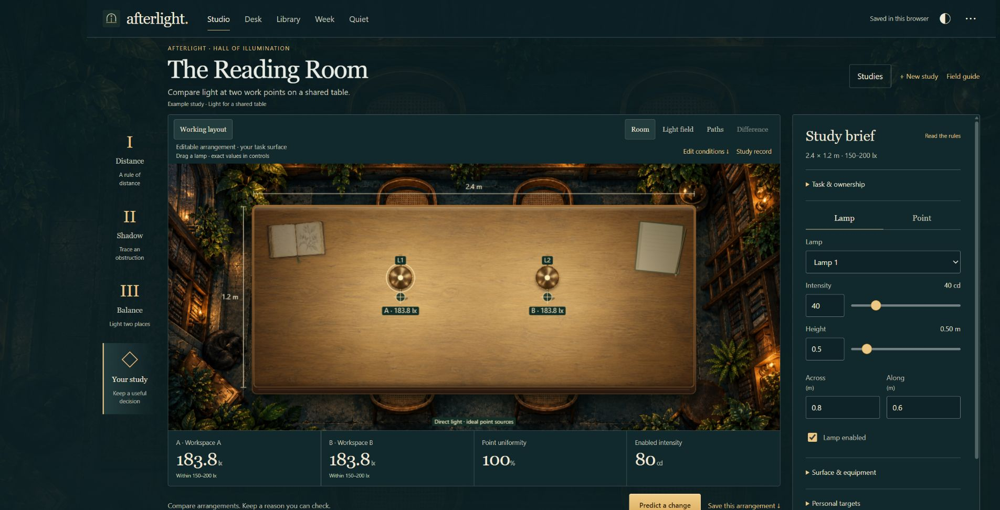
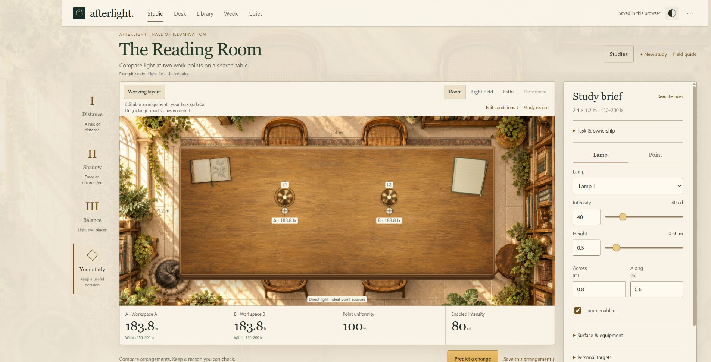
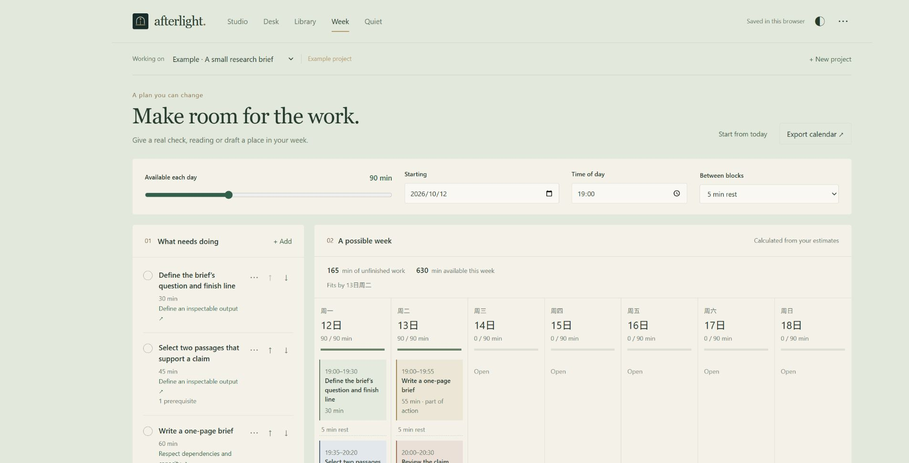

# Afterlight

**Arrange light. Test an explanation. Make room for the next step.**

Afterlight is an interactive lighting studio and a source-linked workspace. It connects a question to its evidence, a decision you can explain, and a plan you can carry out. The illustrated reading room is the setting; the calculations, retained records and practical next actions are the work.

[Browser demo](https://starright00631-dev.github.io/afterlight/) · [Releases](https://github.com/starright00631-dev/afterlight/releases) · [Planner](#a-planner-that-shows-what-fits) · [Local setup](#choose-how-to-run) · [Contributor guide](AGENTS.md)

[](qa/readme-studio-night.png)

The Reading Room combines an illustrated environment with a deterministic direct-light model. Lamps, measurement points, screens, fields and numerical readings are live; the surrounding artwork is decorative. Day and night appearances use the same calculations.

[](qa/readme-studio-day.png)

These are screenshots of the running application. Click an image to inspect the full-resolution PNG. Values shown in lux are calculations, not measurements of a physical room. Example plans and studies are labelled examples.

## From explanation to evidence

An explanation becomes useful when it predicts a change that can be checked. Afterlight records the expected outcome, original conditions, calculations and a separate conclusion. A correct prediction does not establish mastery or learning gains.

Start with a lighting question, such as whether two work points on a shared table can meet your chosen range. Use the distance, shadow and balance commissions to explore the rules, or create a personal study.

| Step | What you do | What is retained |
| --- | --- | --- |
| **Arrange** | Move lamps or use exact numeric controls; set points and personal targets. | Saved arrangements with their own geometry and calculated readings. |
| **Predict** | Commit an expected change and an explanation, then edit the proposal and run it. | The frozen baseline, original hypothesis, result and separate conclusion. Proposed readings stay covered until Run. |
| **Compare** | Select two saved arrangements on the same surface and point coordinates. | Point readings, target margins, lamp contributions and a signed **B minus A** field. |
| **Choose** | Keep an arrangement with a reason, supporting evidence and a next check. | The selected comparison and target revision, preserved when later edits occur. |

**Room**, **Light field** and **Paths** show the layout, distribution and direct-light paths. **Difference** compares retained arrangements on a symmetric scale: amber means more light in B, blue means less. Mismatched setups are rejected. Changing several controls at once does not isolate one cause.

Actual meter readings can be recorded separately, with their instrument and context. They remain distinct from calculations and do not automatically calibrate the model.

In Room view, the book opens the **Field guide** and the notebook opens the **Study record**. Labelled buttons provide the same actions on small screens and with a keyboard. **Return to table** completes the route. Lamps and points use the same physical coordinates as their numeric controls, including when the table is resized. Material artwork has a procedural fallback if an image cannot load.

## A planner that shows what fits

**Week** turns named outputs into timed work blocks. Choose a starting date, time of day, daily budget and rest gap; give each action an estimate, prerequisites, optional deadline and status. Editing those inputs recalculates the plan immediately. A scheduled block opens its action in **Desk**, where its draft, supporting idea and focus time remain together.

The planner follows explicit rules in [domain.js](domain.js):

- Prerequisites are placed before dependent actions. A dependent action's earlier deadline also gives its prerequisites priority.
- Ready actions are ordered by their effective deadline, then their order in the action list.
- Longer actions can span days. Rest between blocks consumes the same daily budget; no rest is charged before the first or after the final block.
- Completed actions leave the unfinished-work schedule. Blocked work, missing or cyclic prerequisites, impossible deadlines and unplaced minutes remain visible with a reason.
- A finish date appears only when all unfinished work can be placed.

[](qa/readme-planner.png)

**Reproduce the built-in example:** in **Data and project settings**, add the example project, then open Week. Its four actions form a dependency chain: define the brief's finish line (**30 min**), select evidence (**45 min**), write the brief (**60 min**), and review its claim (**30 min**). With **90 minutes a day**, a **19:00** start and **5-minute** rest gaps, the actual scheduler produces:

| Day | Scheduled work |
| --- | --- |
| **1** | 19:00–19:30 define the output; 19:35–20:20 select evidence; 20:25–20:30 begin the draft. |
| **2** | 19:00–19:55 finish the draft; 20:00–20:30 review the claim. |

That is **165 work minutes plus 15 rest minutes**, filling two 90-minute windows. An earlier deadline or a smaller budget can leave work unplaced; the conflict stays in the plan so you can change the estimate, scope or date.

The interface plans seven days with the same daily window. It uses a deterministic scheduling heuristic, rather than an optimized calendar or a productivity prediction. **Export calendar** downloads an `.ics` file containing scheduled work blocks, with rest represented by gaps; it does not configure reminders or synchronize a calendar. Event times are floating local times interpreted by your calendar application. Default dates and practice queues use the Asia/Shanghai calendar.

## One study, five workspaces

| Workspace | What it does | How it connects |
| --- | --- | --- |
| **Studio** | Test predictions, compare arrangements and retain a decision. Real meter observations remain separate. | **Use in my work** keeps the study report and reason in Desk. **Plan the check** creates a Week action linked back to the study, with a measurement template in its draft. |
| **Desk** | Read sources beside kept passages, explanations, recall attempts and action drafts. Record focus time and report completion yourself. | An idea links to its original passage and can become an action with **Put it to work**. Drafts and scheduled blocks refer to the same action. |
| **Library** | Search and preserve the project's original imported text and its passage anchors. | Open a source in Desk; follow its kept ideas and attached actions in the source map. Sources retained as study-decision evidence cannot be deleted through the interface. |
| **Week** | Fit unfinished work to estimates, prerequisites, deadlines and rest gaps, and expose conflicts. | Open a scheduled block to work on its draft; return to its attached idea or lighting study. |
| **Quiet** | Save what changed and one concrete starting point for later. Optionally use a timer and locally synthesized rain. | **Plan this next step** opens an action form with the handoff prefilled. The handoff also appears when you return to Desk. |

For example, retain a balanced lighting arrangement, use its report in Desk, then plan a 15-minute measurement check. The action draft records the selected arrangement, calculated point values and blank fields for observed lux, instrument, date and ambient conditions. Adding a plan creates no measurement and completes no task automatically.

Desk practice hides the reference while you write, then lets you reveal the original passage and assess your answer. **Again**, **Uncertain** and **Understood** use simple 1-, 3- and 7-day revisit intervals. These are your assessments, not automatic grades or evidence of mastery.

## Choose how to run

Open the [browser demo](https://starright00631-dev.github.io/afterlight/) without installation, or download the local application for provider connections.

| Capability | Browser build | Local server |
| --- | --- | --- |
| Studio, Desk, Library, Week and Quiet | Available | Available |
| Text, Markdown and selectable-text PDF import | Available | Available |
| Study calculations, records, planning and appearance controls | Available | Available |
| Workspace/study backups, HTML/CSV reports and other exports | Available | Available |
| Optional model-provider assistance | Disabled | Available when you configure a provider |

The browser build serves its code, artwork and PDF.js resources from the same site. No Afterlight account or provider is required. Use a current browser with JavaScript, Canvas 2D and working browser storage. Serve the application over HTTP; opening `index.html` directly from disk is unsupported.

### Windows

1. Install [Node.js](https://nodejs.org/): **22.13 or newer**, with **Node 24 LTS recommended**.
2. Download the application archive from [Releases](https://github.com/starright00631-dev/afterlight/releases) and extract the complete `afterlight` folder.
3. Double-click **Start-Afterlight.bat**. The launcher checks Node, installs locked dependencies with `npm ci` when needed, and opens **http://127.0.0.1:5180/**.

Node is not bundled; first dependency installation needs internet access. The server binds to loopback. The launcher uses Windows PowerShell, reuses a matching Afterlight server and reports port collisions without terminating unrelated processes.

### Windows, macOS or Linux terminal

From the extracted application folder:

```bash
npm ci
npm start
```

Open **http://127.0.0.1:5180/**. Keep the terminal open; **Ctrl+C** stops the server. Different ports or hostnames have separate browser storage, so export your workspace before changing origin.

## Sources, privacy and backups

Sources, notes and studies stay in browser-local storage, with no automatic cloud synchronization. The demo and each local origin have separate records. Clearing site data can remove your work.

Use **Data and project settings → Export desk** for a complete workspace backup, including sources. **Export study** provides restorable JSON, HTML and calculated CSV; study-only JSON retains source references, not original source documents. Imports validate supported records and recompute calculations. Browser printing is available, with print-preview and PDF-pagination verification limits recorded in QA.

Text and Markdown can be pasted or imported. Digital PDF intake supports **20 MiB**, **80 pages** and **120,000 extracted characters**, subject to the **160-passage** source limit. Image-only and password-protected PDFs are not supported; there is no OCR. The reader retains extracted text, not original PDF bytes or a page-image viewer. Imported material does not automatically become a validated simulation.

### Optional assistance on localhost

The application works without AI. On localhost, choose a provider in Desk and use **Explain**, **Find ideas** or a specific question. A request contains the selected source's title and passages, plus your question and selected passage anchor. It is sent only when you ask.

| Adapter | Required environment | What a connection check establishes |
| --- | --- | --- |
| **Codex CLI** | A compatible installed executable and an account signed in through `codex login`. | Local login status. Model inference is checked by an actual request. |
| **Claude CLI** | A compatible installed executable and an account signed in through `claude auth login`. | Local authentication status. Model inference is checked by an actual request. |
| **Ollama** | An existing OpenAI-compatible service and installed model. Default base URL: `http://127.0.0.1:11434/v1`. | Reachability and whether the exact model appears in `/models`. |
| **DeepSeek** | An API key and exact model available at `https://api.deepseek.com/v1`. | Access to the model list and selected model. |
| **OpenAI-compatible API** | A base URL, exact model, any required key, and compatible chat-completion and structured-output support. | Model-list access. A public model list may leave key validity unknown. |

Enter API settings in **Choose your assistant**. Choose **JSON**, **JSON schema** or **Prompted JSON only** to match the endpoint. Remote endpoints require HTTPS; HTTP is accepted for loopback. Use the base URL without `/models` or `/chat/completions`. The endpoint must list the selected model before assistance is enabled.

For CLI adapters, `AFTERLIGHT_CODEX_PATH` and `AFTERLIGHT_CLAUDE_PATH` override executable paths before the server starts. On Windows, point to a native executable when the installation only exposes a `.cmd` or `.bat` shim; the adapters launch without a shell. Installed CLI versions must support the flags used in [services/ai.js](services/ai.js) and [services/claude.js](services/claude.js). Account, network and inference availability depend on the provider.

| Adapter | Environment variables |
| --- | --- |
| Ollama | `OLLAMA_BASE_URL`, `OLLAMA_MODEL`, optional `OLLAMA_API_KEY` |
| DeepSeek | `DEEPSEEK_MODEL`, `DEEPSEEK_API_KEY` |
| Compatible API | `AFTERLIGHT_API_BASE_URL`, `AFTERLIGHT_API_MODEL`, optional `AFTERLIGHT_API_KEY`, `AFTERLIGHT_API_NAME`, `AFTERLIGHT_API_RESPONSE_FORMAT` |

Afterlight does not load `.env` files automatically. Set variables in the environment that starts Node, or use the connection dialog. Dialog credentials live in server memory, are excluded from exports and disappear on restart. Environment credentials remain your own configuration.

The repository provides an application server and npm scripts; it has no standalone `afterlight` CLI or MCP server. CLI adapters request constrained, reading-only structured answers. Returned ideas must reference existing passage IDs, and returned citations must quote the source exactly; literal citation validation does not establish semantic correctness. Review suggestions against the source. A connection check sends no source; an assistance request sends the selected source to your provider, whose terms and privacy policy apply. A desktop subscription does not necessarily provide API access.

The hosted browser build disables provider connections and assistance. It does not ask visitors to place API credentials in a public site.

## Physical model

Afterlight models **direct illuminance from isotropic point lamps**, measured at horizontal sample points, with optional opaque vertical screens. Each unobstructed lamp contributes:

```text
E = I × h / (dx² + dy² + h²)^(3/2)
```

`I` is intensity in candela; `dx`, `dy` and `h` are distances in metres; `E` is illuminance in lux. Directly beneath a lamp, the expression becomes `I / h²`. Contributions add, and an obstructed direct path contributes zero.

The model omits ambient light, reflections, diffraction, extended fixtures, spectrum and glare. Windows, candles, furniture and plants in the illustration add no calculated light or obstruction. Field colours compress calculated lux for legibility. Point uniformity applies only to the selected points, and the candela total is **not electrical watts**. The tabletop is an interactive Canvas 2D projection, not a full room renderer.

Personal targets and example commissions are not lighting standards or evidence of compliance, comfort or safety. Applying a layout to a real room requires actual measurements and an appropriate fuller model. No physical-room accuracy, learning gain, mastery, productivity or sleep outcome has been established.

## Development and verification

```bash
git clone https://github.com/starright00631-dev/afterlight.git
cd afterlight
npm ci
npm run check
npm test
```

To create the static site:

```bash
npm run build:pages
```

The generated site is written to `dist/pages`. Serve that folder through HTTP for a local browser check.

| Command | Purpose |
| --- | --- |
| `npm start` | Start the loopback Node server, including local PDF and optional assistance routes. |
| `npm run check` | Check syntax of application and service modules. |
| `npm test` | Run tests for the model, records, planner, adapters, renderer, build and launcher. |
| `npm run build:pages` | Build the provider-disabled static site with bundled PDF.js resources and a file-hash manifest. |
| `node scripts/verify-studio-export.mjs` | Reconcile the retained QA workspace, study, HTML and CSV export fixtures. |

The current [verification report](qa/CURRENT-REPORT.md) records release checks and remaining limits. Automated checks do not replace browser or physical measurement checks. See [AGENTS.md](AGENTS.md) for architecture, privacy boundaries and contributor verification rules. Maintainer packaging additionally requires Python 3.9+; Python is not needed to run the application or npm tests.

## License and credits

The original application code and original artwork are **source-available for noncommercial use** under **[PolyForm Noncommercial 1.0.0](LICENSE)**. Commercial use is not granted by that license. Third-party components retain their own licenses; **PDF.js retains Apache License 2.0**, and its bundled resources retain their applicable notices.

[CREDITS.md](CREDITS.md) records the generated room/material artwork and the projects consulted during research, including [Get It](https://github.com/beltromatti/get-it), Ray Optics, LOOPY and PhET. No application code or artwork from those comparison projects was copied.

[Material generation prompts](docs/table-material-prompts.md) document the tabletop, book and brass-shade refinements.

Maintained by [starright00631-dev](https://github.com/starright00631-dev).
