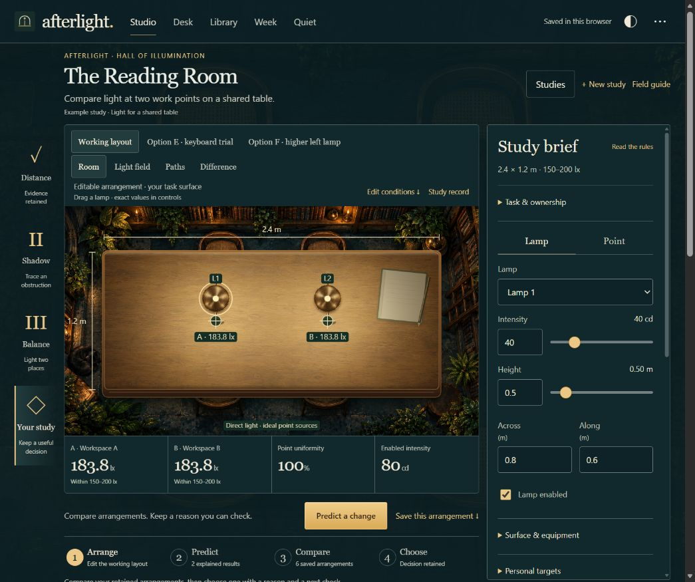
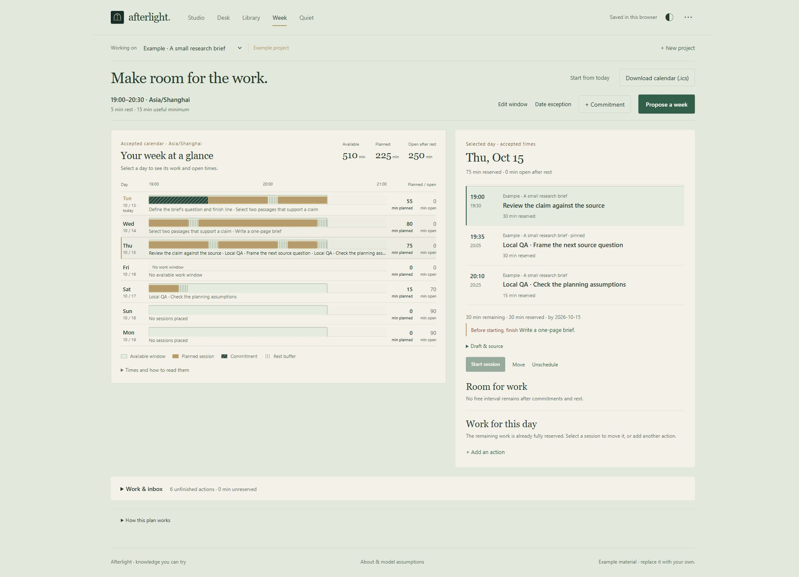

# Afterlight · 把知识变成可以尝试的行动

**Midnight Academy 参赛作品｜应用版本 3.4.0**

Afterlight 是一个可以操作的灯光实验与学习工作空间。用户先调整灯具、提出预测、检验解释，再把证据、阅读笔记和下一步工作连接起来。共享日历展示时间实际能容纳的任务；结束工作时，留下结果和下次继续的位置。

夜间阅读室提供视觉背景。作品的核心是 **问题 → 预测 → 证据 → 选择 → 具体行动 → 已确认时段 → 实际工作结果**。

[在线演示](https://starright00631-dev.github.io/afterlight/) · [完整代码仓库](https://github.com/starright00631-dev/afterlight) · [3.4.0 发布版](https://github.com/starright00631-dev/afterlight/releases/tag/v3.4.0) · [AI 使用说明](AI_USAGE.md) · [三分钟演示路线](SUBMISSION-DEMO.md)



## 功能实现状态

| 功能 | 状态 | 可以实际完成的操作 |
| --- | --- | --- |
| 灯光工作台 | 已实现 | 拖动灯具与测量点；调整高度、强度、桌面尺寸和遮挡屏；查看照度、光场与光路。 |
| 预测与证据 | 已实现 | 先提交预测再揭示结果；分别保存原始条件、解释、结果和结论；比较匹配的保存方案并保留选择理由。 |
| 阅读与来源 | 已实现 | 导入 PDF、文本或 Markdown，先检查文字预览再保存；把笔记、问题和任务关联到原文段落。 |
| 来源关联复习 | 已实现 | 隐藏参考内容后作答，再揭示原文和自定标准；明确评估、跳过或撤销；历史保留当时的问题与原文。 |
| 共享计划 | 已实现 | 跨项目共用可用时间；加入固定安排、关闭日期、休息、任务依赖和截止日期；查看未能安排的工作。 |
| 日历可视化 | 已实现 | 七天使用相同时间刻度；选择日期查看任务与空档；比较已确认／拟议时段，明确接受后才产生预约。 |
| 工作与交接 | 已实现 | 明确开始工作，在 Quiet 保存完成／部分完成／阻塞结果、产出、剩余估算及下一步。计时不会自动完成任务。 |
| 文件交换 | 已实现 | 工作空间 JSON 备份与恢复、已确认日历 ICS、灯光 HTML 报告、Excel 用 CSV 和单个研究 JSON。 |
| 昼夜与小屏布局 | 已实现 | 同一套数据切换昼夜视觉；桌面并排、小屏纵向布局；提供触摸与键盘对应控件。 |
| 可选模型辅助 | 已实现，需配置环境 | 本地服务可接入已配置的 CLI／兼容 API；公开演示关闭此功能。本次不声称已验证真实模型推理。 |
| 扫描件 OCR、日历账户同步、自动评分 | 未实现 | 不是当前版本的承诺；扫描件需文字稿，日历导出是快照，理解程度由用户评估。 |



## 有用的知识在哪里

灯光实验把距离、入射角、强度叠加和直射遮挡变成可改变、可预测的规则。模型使用米、坎德拉和勒克斯。理想点灯对水平测量点的贡献为：

```text
E = I × h / (dx² + dy² + h²)^(3/2)
```

正下方简化为 `E = I / h²`。例如保持 **32 cd**，高度从 **0.8 m** 降到 **0.4 m**，计算值从 **50 lx** 变成 **200 lx**。这些是确定性模型结果，不是现实房间的测量。

另一类知识来自用户自己的阅读材料：保留原文段落、自己的解释、回忆问题与答案标准，再把理解转成可检查的产出。计划器负责判断下一步是否能放进时间，而不把“有计划”当成“已完成”。

## 如何运行

### 直接体验

打开 [在线演示](https://starright00631-dev.github.io/afterlight/)。核心功能无需账户或模型服务。数据保存在当前浏览器中；使用一个活动标签页，避免同时编辑同一工作空间。

### 本地应用

需要 **Node.js 22.13 或更新版本**，推荐 Node 24 LTS。首次安装依赖需要联网。

- Windows：在本目录双击 **Start-Afterlight.bat**。
- Windows、macOS、Linux：在本目录运行：

```bash
npm ci
npm start
```

然后访问 `http://127.0.0.1:5180/`。服务绑定到本机回环地址。不要直接打开 `index.html`。不同域名和端口拥有独立的浏览器记录；搬迁前保存工作空间备份。

### 检查源码

```bash
npm run check
npm test
node scripts/verify-studio-export.mjs
node scripts/verify-workbench-export.mjs
node scripts/verify-week-refinement.mjs
npm run build:pages
```

[独立提交 ZIP](https://github.com/starright00631-dev/afterlight/releases/download/v3.4.0/afterlight-submission.zip) 保留完整应用代码、锁定依赖、浏览器构建脚本和 Node 测试，并排除私人对话、原始素材生成提示词、开发研究档案、已安装依赖及本地凭据。排除范围指该 ZIP 和本次新增 AI 记录材料；公开仓库保留既有维护历史与合法署名。本概要提供当前仓库的项目说明。

## 核心文件清单

| 文件 | 作用 |
| --- | --- |
| `index.html`、`app.js`、`style.css` | 五个工作空间的入口、连接和界面。 |
| `optics.js` | 直射照度、遮挡、物理坐标与输入校验。 |
| `studio-renderer.js`、`studio.css` | 实时桌面投影、拖动、光场、光路及素材显示。 |
| `studies.js`、`field-difference.js` | 冻结预测、保存方案、比较、选择与证据导出。 |
| `studio-ui.js`、`studio-view-state.js` | 研究控件、结果遮盖和只读状态。 |
| `source-intake.js`、`browser-pdf.js`、`services/pdf.js` | 文字／文件预览、显式保存及 PDF 文字提取。 |
| `domain.js` | 原文分段、段落锚点、复习日期和基础记录。 |
| `workspace-planner.js`、`calendar.js` | 共享容量、依赖、时段校验和日历导出。 |
| `agenda-ui.js`、`calendar-overview.js`、`calendar-overview.css`、`planning-inspector.js` | 七天图、日期详情、预约管理和有效放置候选。 |
| `review-sessions.js`、`review-ui.js` | 有界复习队列、隐藏／揭示、评估快照及撤销。 |
| `workbench-state.js`、`work-sessions.js` | 计划关联、实际工作结果与剩余估算。 |
| `persistence.js` | v4 工作空间校验、v3/v2 迁移与恢复边界。 |
| `server.js`、`client-services.js`、`runtime-capabilities.js`、`services/` | 本地 HTTP、PDF 路由与可选辅助；区分本地和公开浏览器能力。 |
| `scripts/`、`tests/` | Windows 启动、静态构建、源码检查、导出核对与回归测试。 |
| `assets/`、`licenses/` | 装饰位图／标识与第三方许可。 |

## 提交材料

| 材料 | 位置 |
| --- | --- |
| 源代码与运行入口 | 当前仓库的应用文件、`services/`、`scripts/`、`tests/`，以及发布版附带的独立提交 ZIP；入口为 `Start-Afterlight.bat` 或 `npm start`。 |
| 项目说明、实现状态、核心文件 | 本概要及仓库 README。 |
| AI 参与说明 | [AI_USAGE.md](AI_USAGE.md)。 |
| 提示词材料 | [ai-logs/](ai-logs/README.md)：明确标注的重建示例，**不是原始对话或历史日志**。原始内容因隐私未提供。是否可替代活动所需对话记录，需主办方确认。 |
| 实际运行截图 | [screenshots/](screenshots/README.md)，共 6 张，不使用生成概念图冒充运行界面。 |
| 演示 | [在线网页](https://starright00631-dev.github.io/afterlight/)，另附 [180 秒演示路线](SUBMISSION-DEMO.md)。 |
| 验证与边界 | [VERIFICATION.md](SUBMISSION-VERIFICATION.md)。 |
| 公开素材来源 | 仓库既有说明见 [CREDITS.md](CREDITS.md)；独立提交 ZIP 的公开摘要不含原始生成提示词。 |

## 边界与许可

这是 Canvas 2D 投影与理想直射光模型；没有环境光、反射、眩光、光谱或真实房间校准。房间和纸本等装饰不参与计算，坎德拉不是电功率。目标范围是用户／练习设定，不是照明合规认证。

PDF 支持可提取文字的文件，限制为 **20 MiB、80 页、120,000 字符、2,000 段落**，不含 OCR 或原始页图查看器。计划是确定性启发式；复习采用固定 **1／3／7 天**自评回访，不证明效率、掌握程度、学习增益或睡眠健康效果。更多限制见验证说明。

原始代码、文档与原创装饰素材按 [PolyForm Noncommercial 1.0.0](LICENSE) 提供，限非商业使用。保留 [NOTICE](NOTICE)、[第三方说明](THIRD-PARTY-NOTICES.md) 和 `licenses/`。PDF.js 保留 Apache 2.0 许可，其可选本地 Canvas 依赖保留 MIT 许可。
